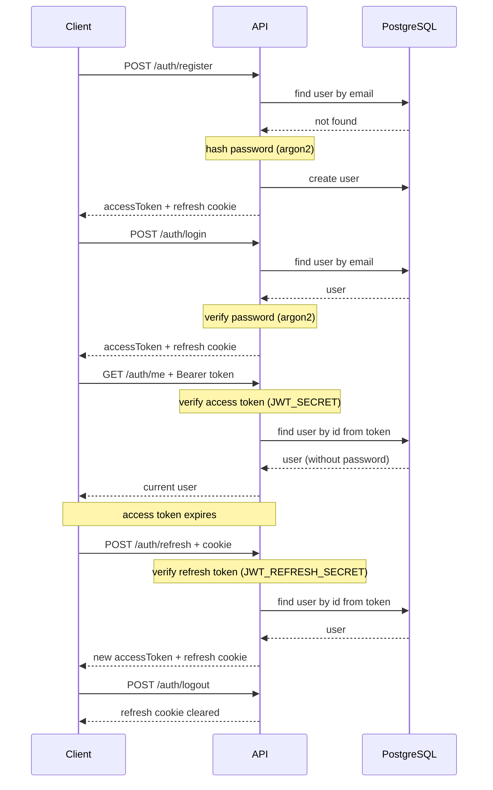

# NestJS Simple Auth

A small, self-contained example of JWT authentication in [NestJS](https://nestjs.com/) with [Prisma](https://www.prisma.io/) and PostgreSQL.

It shows the common **access token + refresh token** pattern: a short-lived access token returned in the response body, and a long-lived refresh token stored in an `httpOnly` cookie.

**[API documentation](https://oppositeart.github.io/nestjs-simple-auth/)**

## Features

- Register, login, refresh, logout and "current user" endpoints
- Passwords hashed with [argon2](https://github.com/ranisalt/node-argon2)
- Short-lived **access token** sent as `Authorization: Bearer <token>`
- Long-lived **refresh token** in an `httpOnly`, `SameSite=Lax` cookie (`Secure` outside development)
- Access and refresh tokens are signed with **different secrets**, so one can't be used in place of the other
- Login returns the same `401` for an unknown email and a wrong password, and takes the same time in both cases
- Protected routes via a single `@Authorization()` decorator and the current user via `@CurrentUser()`
- Request validation with `class-validator` (unknown fields are stripped)
- Password is never returned: it's omitted globally in the Prisma client
- Interactive API docs with Swagger

## Tech stack

|            |                                                    |
| ---------- | -------------------------------------------------- |
| Framework  | NestJS 12, Express 5                               |
| Auth       | Passport + `passport-jwt`, `@nestjs/jwt`           |
| Database   | PostgreSQL 18, Prisma ORM 7 (`@prisma/adapter-pg`) |
| Validation | `class-validator`, `class-transformer`             |
| Docs       | `@nestjs/swagger`                                  |
| Tooling    | TypeScript, oxlint, Prettier, Vitest               |

## How it works



| Token         | Where it lives                                                | Lifetime                         | Signed with          |
| ------------- | ------------------------------------------------------------- | -------------------------------- | -------------------- |
| Access token  | Response body → client sends it in the `Authorization` header | `JWT_ACCESS_TTL` (default `30m`) | `JWT_SECRET`         |
| Refresh token | `httpOnly` cookie, not readable from JavaScript               | `JWT_REFRESH_TTL` (default `7d`) | `JWT_REFRESH_SECRET` |

## Getting started

### Prerequisites

- Node.js 24 or newer
- Docker (for PostgreSQL), or your own PostgreSQL 15+ instance

### Setup

1. Install dependencies. This also generates the Prisma client (`postinstall`):

   ```bash
   npm install
   ```

2. Create your `.env` from the example and replace the placeholders. Use two different random values for the JWT secrets, for example `openssl rand -hex 64`:

   ```bash
   cp .env.example .env
   ```

3. Start PostgreSQL. Docker Compose reads the database user and password from `.env`:

   ```bash
   docker compose up -d
   ```

4. Create the database and tables from the Prisma schema:

   ```bash
   npx prisma db push
   ```

5. Start the app in watch mode:

   ```bash
   npm run start:dev
   ```

The API runs on [http://localhost:3000](http://localhost:3000) (set `PORT` to change it), and the Swagger docs are at [http://localhost:3000/docs](http://localhost:3000/docs).

### Environment variables

| Variable                                              | Description                                                                        |
| ----------------------------------------------------- | ---------------------------------------------------------------------------------- |
| `NODE_ENV`                                            | `development` disables the `Secure` flag on the cookie so it works over plain HTTP |
| `POSTGRES_USER`, `POSTGRES_PASSWORD`                  | Database credentials, also used by `docker-compose.yml`                            |
| `POSTGRES_HOST`, `POSTGRES_PORT`, `POSTGRES_DATABASE` | Database location (Docker exposes Postgres on port `5433`)                         |
| `POSTGRES_URI`                                        | Connection string, built from the variables above                                  |
| `JWT_SECRET`                                          | Secret for signing access tokens                                                   |
| `JWT_REFRESH_SECRET`                                  | Secret for signing refresh tokens; must differ from `JWT_SECRET`                   |
| `JWT_ACCESS_TTL`                                      | Access token lifetime, e.g. `30m`                                                  |
| `JWT_REFRESH_TTL`                                     | Refresh token lifetime, e.g. `7d`                                                  |
| `COOKIE_DOMAIN`                                       | Domain of the refresh token cookie, e.g. `localhost`                               |

## API

| Method | Endpoint         | Auth           | Description                                                              |
| ------ | ---------------- | -------------- | ------------------------------------------------------------------------ |
| `POST` | `/auth/register` | —              | Create an account. Returns `{ accessToken }` and sets the refresh cookie |
| `POST` | `/auth/login`    | —              | Log in. Returns `{ accessToken }` and sets the refresh cookie            |
| `POST` | `/auth/refresh`  | Refresh cookie | Issue a new access token and refresh cookie                              |
| `POST` | `/auth/logout`   | —              | Clear the refresh cookie                                                 |
| `GET`  | `/auth/me`       | Bearer token   | Return the current user                                                  |

To try the protected endpoint in Swagger, call `/auth/login`, copy the `accessToken`, click **Authorize** and paste it.

The same spec is published as read-only [API documentation](https://oppositeart.github.io/nestjs-simple-auth/) on GitHub Pages. It's built from [`docs/openapi.json`](docs/openapi.json); after changing endpoints or DTOs, run `npm run docs:export` and commit the updated file.

### Examples with Postman

The repo includes a ready-to-use Postman collection: [`postman/nestjs-simple-auth.postman_collection.json`](postman/nestjs-simple-auth.postman_collection.json).

1. Start the app (see [Setup](#setup)).
2. In Postman, click **Import** and select the collection file.
3. Run the requests in order: **Register** (or **Login** if the account already exists) → **Me** → **Refresh** → **Logout**. You can also run them all at once with the Collection Runner.

You don't need to copy any tokens:

- **Register**, **Login** and **Refresh** save the returned access token to the `accessToken` collection variable.
- **Me** inherits the collection's Bearer auth, so it sends `Authorization: Bearer {{accessToken}}` automatically.
- The refresh token is an `httpOnly` cookie. Postman's cookie jar stores it after Register or Login and sends it with **Refresh**, the same way a browser would.
- **Logout** clears the cookie and the saved access token, so **Me** returns `401` afterwards.

The account details (`name`, `email`, `password`) and `baseUrl` are collection variables. Change them in the collection's **Variables** tab.

Example response from **Me**:

```json
{
  "id": "3f1c2b7e-8a4d-4f6b-9c2e-1d5a7b9e0f12",
  "name": "admin",
  "email": "admin@gmail.com",
  "createdAt": "2026-11-01T12:00:00.000Z",
  "updatedAt": "2026-11-01T12:00:00.000Z"
}
```

### Examples with fetch

The same flow with the built-in `fetch`. The snippets run as-is in Node.js 24 (save them as an `.mjs` file).

Register a user. The response body holds the access token, and the `Set-Cookie` header holds the refresh token:

```js
const API_URL = 'http://localhost:3000';

const registerRes = await fetch(`${API_URL}/auth/register`, {
  method: 'POST',
  headers: { 'Content-Type': 'application/json' },
  body: JSON.stringify({
    name: 'admin',
    email: 'admin@gmail.com',
    password: 'qwerty123',
  }),
});

const { accessToken } = await registerRes.json();
const [refreshCookie] = registerRes.headers.getSetCookie();
```

`/auth/login` works the same way with `{ email, password }` in the body.

Get the current user with the access token:

```js
const meRes = await fetch(`${API_URL}/auth/me`, {
  headers: { Authorization: `Bearer ${accessToken}` },
});

console.log(await meRes.json());
```

Get a new access token with the refresh cookie. Node.js doesn't store cookies, so the cookie is passed on by hand:

```js
const refreshRes = await fetch(`${API_URL}/auth/refresh`, {
  method: 'POST',
  headers: { Cookie: refreshCookie.split(';')[0] },
});

const { accessToken: newAccessToken } = await refreshRes.json();
```

Log out. The response clears the refresh cookie:

```js
const logoutRes = await fetch(`${API_URL}/auth/logout`, { method: 'POST' });

console.log(await logoutRes.json()); // true
```

### Validation rules

| Field      | Rule                                    |
| ---------- | --------------------------------------- |
| `name`     | String, 3–32 characters (register only) |
| `email`    | Valid email address                     |
| `password` | String, 8–32 characters                 |

## Project structure

```
src/
├── auth/
│   ├── decorators/    # @Authorization() and @CurrentUser()
│   ├── dto/           # Request and response DTOs (validation + Swagger)
│   ├── guards/        # JwtGuard
│   ├── interfaces/    # JWT payload type
│   ├── strategies/    # Passport JWT strategy
│   ├── auth.controller.ts
│   ├── auth.module.ts
│   └── auth.service.ts
├── config/            # JWT and Swagger configuration
├── prisma/            # PrismaService (global module)
├── utils/
├── app.module.ts
└── main.ts
prisma/
└── schema.prisma      # User model
docs/                  # GitHub Pages API docs (Redoc + openapi.json)
postman/               # Postman collection
scripts/
└── export-openapi.js  # Writes docs/openapi.json
```

The Prisma client is generated into `src/generated/prisma` and is not committed.

## Scripts

| Command               | Description                                                     |
| --------------------- | --------------------------------------------------------------- |
| `npm run start:dev`   | Start in watch mode                                             |
| `npm run build`       | Compile to `dist/`                                              |
| `npm run start:prod`  | Run the compiled app                                            |
| `npm run lint`        | Lint with oxlint                                                |
| `npm run format`      | Format with Prettier                                            |
| `npm run docs:export` | Build the app and write the OpenAPI spec to `docs/openapi.json` |

## Limitations

This project is meant as a learning example, so a few things are intentionally kept simple:

- Tokens are stateless. Logout clears the cookie, but a refresh token that was copied earlier stays valid until it expires. A production setup would store refresh tokens (or their hashes) in the database so they can be revoked and rotated.
- There's no email verification, password reset or rate limiting on login.
